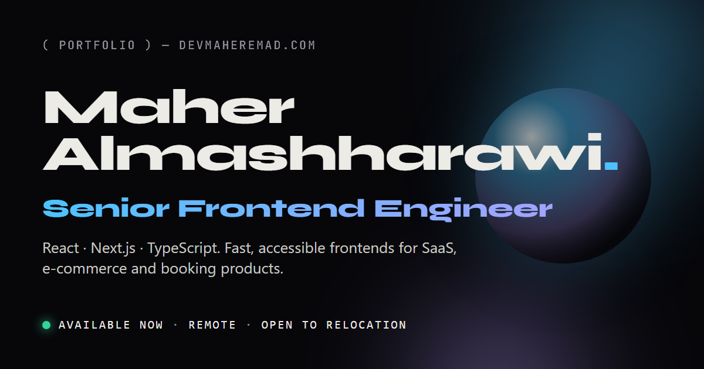

# Maher Almashharawi — Portfolio

**Live:** https://devmaheremad.com



Personal site of a Senior Frontend Engineer (React, Next.js, TypeScript). A static Next.js export with a WebGL hero,
smooth scrolling and scroll-driven animation, kept fast: Lighthouse 90+ performance and 100 accessibility, best practices and SEO.

## What's inside
- **WebGL hero** (React Three Fiber + drei): a glass knot with `MeshTransmissionMaterial` refracting the name behind it.
  It follows the pointer; press and hold to "overdrive" it, then the page scrolls to the work.
  Browsers without a real GPU (SwiftShader or llvmpipe, as in Lighthouse or PageSpeed Insights) get a CSS version of the scene instead.
  The scene only renders while the hero is on screen.
- **Motion:** GSAP (ScrollTrigger, SplitText) driven by Lenis smooth scroll on one ticker. Pinned horizontal gallery,
  scroll-scrubbed word reveal, velocity-skewed marquee, magnetic buttons and a custom blend-mode cursor.
- **Content** lives in `src/content/site.ts` and comes from the CV only.
- **Two languages:** every page exists in English and in Arabic under `/ar/` (right-to-left, Arabic fonts). Pages are
  built once in `src/views/` and rendered per language; the Arabic text is in `src/content/stories.ar.ts` and `ar.ts`.
- **Static export** (`output: "export"`), deployed to GitHub Pages by `.github/workflows/deploy.yml` on every push to `main`.

## Run locally
```bash
npm install
npm run dev
```

## Scripts
- `python scripts/capture.py [name ...]` refreshes the project screenshots in `public/work/` with headless Edge.
- `scripts/brand/` holds the HTML sources of the link previews (`og-en.html`, `og-ar.html`) and the "M." icon
  (`icon.html`, `icon-square.html` for Apple). Render them with headless Edge at 1200×630 or 512×512; the icon becomes
  `src/app/favicon.ico` (16, 32, 48), `src/app/icon.png` (192) and `src/app/apple-icon.png` (180, from the square one).

## Stack
Next.js 16 · React 19 · TypeScript · Tailwind CSS 4 · Three.js · React Three Fiber · drei · GSAP · Lenis

---

**Maher Almashharawi** · Senior Frontend Engineer (React, Next.js, TypeScript)
[devmaheremad.com](https://devmaheremad.com) · [Case studies](https://devmaheremad.com/case-studies/) · [LinkedIn](https://www.linkedin.com/in/devmaheremad) · hello@devmaheremad.com
